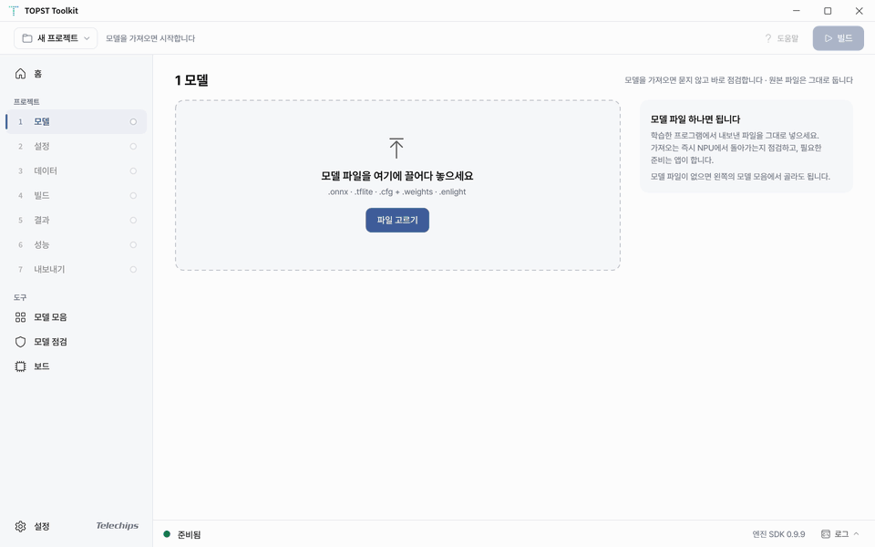
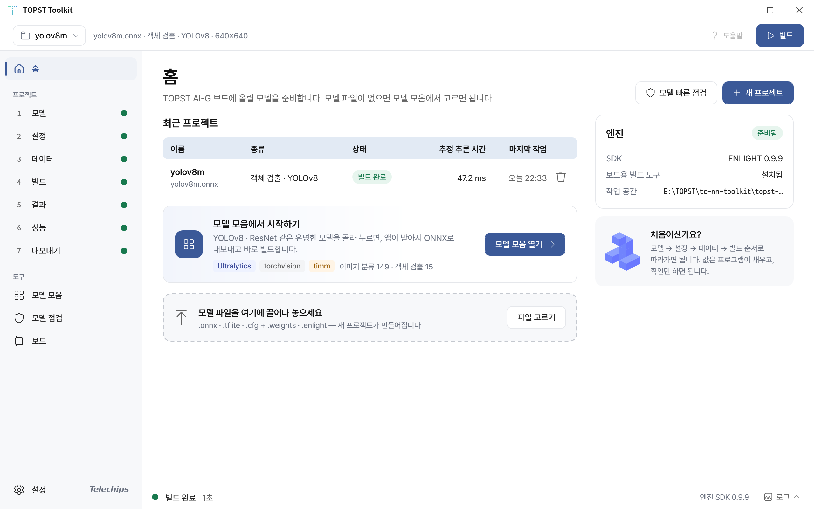
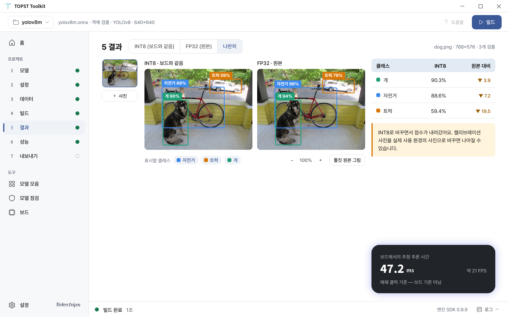
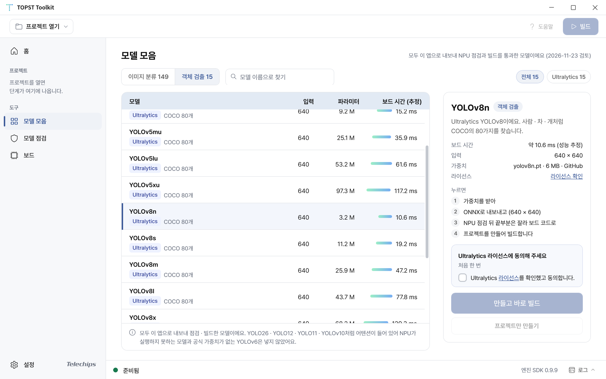
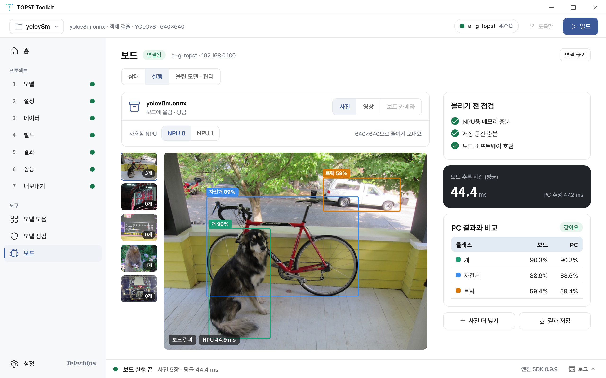

# TOPST Toolkit

TOPST AI-G 보드의 NPU에서 돌릴 모델을 **Windows에서, 리눅스 없이** 준비하는 프로그램입니다.
모델 파일을 넣으면 NPU 점검 → 보드용 빌드 → 결과 비교 → 보드로 내보내기까지 화면을 따라가며 끝낼 수 있습니다.

## 내려받기

**[최신 버전 받기](https://github.com/Onion-Lab/TOPST-Toolkit/releases/latest)**: `TOPST-Toolkit-Setup-<버전>.exe`를 실행하면 됩니다.

- Windows 10(1809 이상) · 11, 64비트
- 설치하면서 엔진(TOPST AI-G NPU Toolkit)과 보드 도구(Arm 크로스 컴파일러)를 각 공식 출처에서 받습니다(약 1.9 GB).
- 새 버전이 나오면 앱이 알려 주고, 버튼 두 번으로 업데이트합니다.

## 한눈에 보기

| | |
|:---:|:---:|
|  |  |
| **모델 넣기**: `.onnx` · `.tflite` · `.cfg`+`.weights` 파일을 끌어다 놓으면 시작 | **결과 비교**: 보드와 같은 INT8 결과와 FP32 결과를 사진 위에서 나란히 |
|  |  |
| **모델 모음**: YOLOv8 · ResNet 같은 모델을 골라 바로 빌드 | **보드에서 실행**: 보드의 NPU에서 돌리고 PC 결과와 비교 |

NPU에서 돌지 못하는 연산이 있으면 앱이 찾아 잘라 내고, 그 부분을 보드 CPU에서 도는 코드로 만들어 줍니다.
